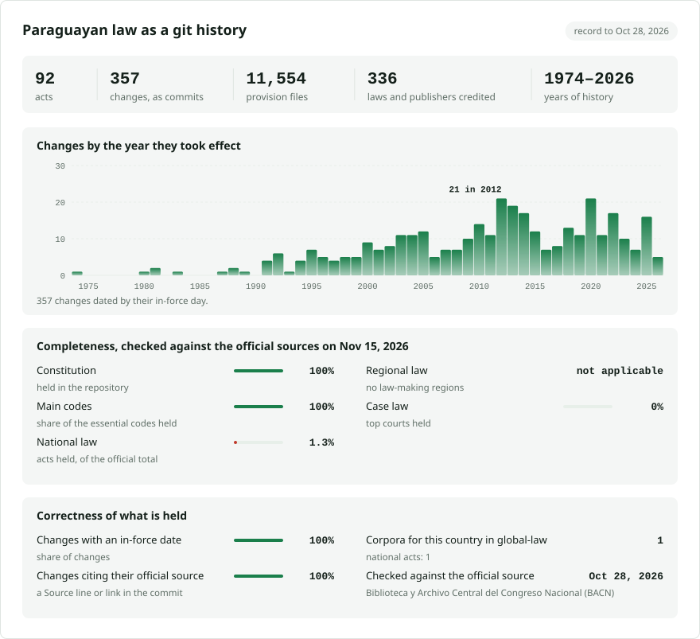

# Paraguay: law history in git

[Español](README.md) · **English**

<picture>
<source media="(prefers-color-scheme: dark)" srcset="data/effort-dark.svg">

</picture>

The national law of Paraguay as a git history: one file per article, one commit per amending law on the day its changes took effect, and that law as the commit's author. `git blame` names the law behind every paragraph; `git log` lists every change to an article; picking a date gives the text in force that day.

Part of [lexifina/global-law](https://github.com/lexifina/global-law), one git history for every country's law: this is Paraguay's national law, which global-law reads at `paraguay/national/acts/`.

**What is in it now:** the Constitution of 1992, 8 codes (among them the Código Civil, the Código Penal and both procedure codes) and 83 laws, with 384 versions; six of the laws have since been repealed and keep their history. Ley 7593/2025 on personal data, in force from 28 November 2027, is on the `futuro` branch. [`data/versions.json`](data/versions.json) lists every act with its versions; [`data/laws.csv`](data/laws.csv) lists the 336 laws the record names.

Each act is a folder named after it (`constitucion/`, `codigo-civil/`, `ley-defensa-consumidor/`), with one file per article: `codigo-civil/art-0036.md` is art. 36 of the Código Civil (Ley N° 1183/1985). Each folder's `README.md` lists its provisions, and its `indice.md`, where it has one, its headings.

The text is in Spanish, as BACN, the Library and Archive of the National Congress, prints it. Text in Guaraní and translations are not part of this record.

## Questions as git commands

| Question | Command |
| --- | --- |
| Every change to art. 36 of the Civil Code | `git log -p --word-diff -- codigo-civil/art-0036.md` |
| Which law wrote each paragraph of art. 36? | `git blame codigo-civil/art-0036.md` |
| Every version of the Civil Code, with the day each took effect | `git log --author=bacn.invalid --format="%h %(trailers:key=In-force,valueonly,separator=) %an" -- codigo-civil` |
| Art. 36 as in force on 1 January 2003 (majority at 20) | `python tools/en_vigor_el.py 2003-01-01 codigo-civil 36` |

**Outside git**, we also host this record publicly, for free:

- **[Ask Claude about Paraguayan law](https://global-law.lexifina.com/v1/try_claude?country=paraguay)**: opens Claude with a first question ready.
- **[Ask ChatGPT](https://global-law.lexifina.com/v1/try_chatgpt?country=paraguay)**: the same question in ChatGPT.
- **[Search Paraguayan law on our site](https://lexifina.com/law?country=paraguay&q=vacaciones+anuales)**: a search for "vacaciones anuales", with each provision's text and its versions, no account needed.
- **[Developer REST API](https://global-law.lexifina.com/v1/search_law?query=vacaciones+anuales&jurisdiction=paraguay)**: the same search as JSON, with no key. See the [documentation here](https://lexifina.com/api/global-law).

Both assistants read the record through the free Global law connector (MCP, `https://global-law.lexifina.com/mcp`); the first time, the chat gives you the link that adds it. Ask in Spanish or in English.

**Host it yourself easily.** All it takes is git and Python, and the tools run on your machine:

```sh
git clone --depth 1 https://github.com/lexifina/global-law && cd global-law
python3 tools/countries.py add paraguay/national/acts
python3 tools/law.py show 2026-01-01 paraguay/national/acts/codigo-civil/art-0036.md
```

Opened in Claude Code, Cursor, VS Code or Codex, the clone also starts a local MCP server with the same tools ([MCP.md](https://github.com/lexifina/global-law/blob/main/MCP.md)).

## Dates

Each commit is dated at noon, America/Asuncion, on the day the change took effect, and carries it in its `In-force:` trailer:

- a law binds from the day after its publication, or from the day it sets itself (Código Civil art. 1); it binds only once promulgated and published (Constitución art. 213);
- the Constitution took effect on 20 June 1992, and Enmienda N° 1 (art. 120), approved by referendum, on 17 October 2011, the day it was declared sanctioned and promulgated;
- where BACN gives no usable publication date, a version is dated the day after promulgation, and a start day set before publication is dated from publication; [`REPRODUCE.md`](REPRODUCE.md) lists each case.

Each change is credited to the law that made it, at an address that cannot exist (`ley-2169-2003@bacn.invalid`), so `git blame` and `git log --author` name laws; the committer is Lexifina. The one change no law explains (art. 2 of the narcotics law, Ley 1340/1988, from 18 February 1992, whose decree-law wording is not in the source) is credited to the publisher, BACN.

## How it is checked

- `tools/check_repo.py` reads every version back from git on the day it took effect and on the day before; both must match the corpus: 386 versions of 93 acts, the `futuro` branch included, 0 mismatches ([`REPRODUCE.md`](REPRODUCE.md)).
- BACN keeps no earlier versions, so every earlier version is a replay: the enacted text plus each amending law found with BACN's own search, applied from that law's text. The replay stops with an error if a law rewrites or repeals an article not in force.
- The current Constitution equals BACN's page in every provision but art. 120, where BACN still prints the 1992 wording; art. 120 follows the signed original of the Enmienda.
- History is append-only: no merge commits on `main`, no commit dates that go backwards, nothing dated in the future, and every commit's trailers parse.
- [vulnerabilities/](vulnerabilities/README.en.md): possible drafting mistakes in Paraguayan law, found by global-law's detectors and checked by hand.

## What it does not show

- **Most national law.** BACN's sitemap lists 7,126 law pages; 92 acts are here. The Labour Code (Ley 213/1993) is left out: Ley 496/1995 ordered it renumbered, and no official renumbered text is published.
- **An official consolidated text** of any code to check the current text against; none is published.
- **Changes with no day in the sources.** Laws whose start is left to a decree not on BACN (Ley 6380/2019, the tax reform, and parts of Leyes 2421/2004, 5061/2013 and 6620/2020), Ley 7663/2026 (Code of Civil Procedure, awaiting the Supreme Court's rules) and laws not on BACN are not applied; the articles keep their earlier wording.
- **Some text:** five Civil Code articles (733, 1170, 1571, 2414, 2566) and nine of the Código Sanitario (123-130, 321) that BACN's text skips, and the Penal Code's book, title and chapter headings, which its amending laws rearranged.
- **Decrees, bills and case law.** The Gaceta Oficial and SILpy, the Congress bill tracker, are not sources of this record, and rulings of unconstitutionality apply to the case, not the text.

## Sources

| Source | Kind | Past versions | Notes |
| --- | --- | --- | --- |
| [BACN, Biblioteca y Archivo Central del Congreso Nacional](https://www.bacn.gov.py/leyes-paraguayas) | Official legislation (Leyes Paraguayas) | no: the current text, partly annotated "(Modificado por …)" | Each act as enacted and each amending law's own text; signed originals as PDF scans |

## Licence

See [`LICENSE`](LICENSE). The legal texts are official texts of the Republic of Paraguay, as BACN publishes them; BACN states no licence for its pages, and official legal texts are public. Lexifina's own contributions (the arrangement of the history, the commit messages, the tables and the tools) are CC0 1.0.

No AI model wrote, translated or corrected legal text, and none runs at build time. Claude Code running Claude Opus 5.5 wrote the scripts, found the amending laws with BACN's search and read them to write the replay table (which article each law rewrites or repeals, and when); see [`REPRODUCE.md`](REPRODUCE.md).

## More

From [lexifina/global-law](https://github.com/lexifina/global-law):

- [FEATURES.md](https://github.com/lexifina/global-law/blob/main/FEATURES.md): every feature, and what every corpus must support (`git blame`, `law.py`, the MCP tools)
- [FAQ.md](https://github.com/lexifina/global-law/blob/main/FAQ.md): questions and answers · [CONTRIBUTING.md](https://github.com/lexifina/global-law/blob/main/CONTRIBUTING.md): proposing changes · [MCP.md](https://github.com/lexifina/global-law/blob/main/MCP.md): the MCP server · [REPRODUCE.md](https://github.com/lexifina/global-law/blob/main/REPRODUCE.md): how it was built · [CHANGELOG.md](https://github.com/lexifina/global-law/blob/main/CHANGELOG.md)
- [FRESHNESS.md](https://github.com/lexifina/global-law/blob/main/FRESHNESS.md): how current each corpus is · [Monitoring](https://github.com/lexifina/global-law/tree/main/monitoring): whether updates are running · [WATCHING.md](https://github.com/lexifina/global-law/blob/main/WATCHING.md): how each official source is watched for changes
- [performance/](https://github.com/lexifina/global-law/tree/main/performance): how fast the tools are, measured
- [visualisations/](https://github.com/lexifina/global-law/tree/main/visualisations): charts and bridges across the world's law
- [Vulnerabilities](https://github.com/lexifina/global-law/tree/main/vulnerabilities): mistakes in legislation as published
