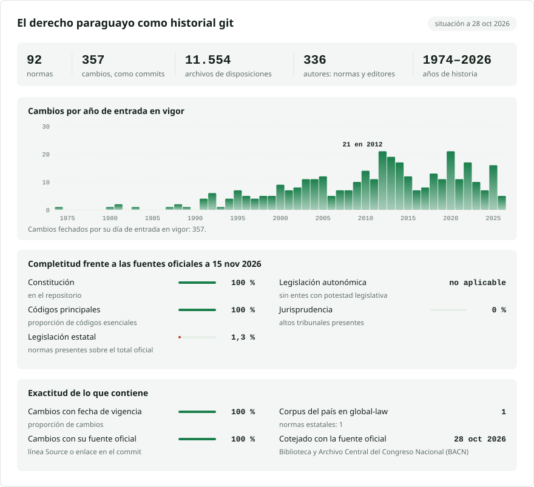

# Paraguay: historia del derecho en git

**Español** · [English](README.en.md)

<picture>
<source media="(prefers-color-scheme: dark)" srcset="data/es/effort-dark.svg">

</picture>

El derecho nacional del Paraguay como historial de git: un archivo por artículo, un commit por ley modificatoria, fechado el día en que entraron en vigencia sus cambios, y esa ley como autora del commit. `git blame` nombra la ley de cada párrafo; `git log` enumera cada cambio de un artículo; al elegir una fecha se obtiene el texto vigente ese día.

Forma parte de [lexifina/global-law](https://github.com/lexifina/global-law), un único historial de git para el derecho de todos los países: este es el derecho nacional del Paraguay, que global-law lee en `paraguay/national/acts/`.

**Qué contiene ahora:** la Constitución de 1992, 8 códigos (entre ellos el Código Civil, el Código Penal y los dos códigos procesales) y 83 leyes, con 384 versiones; seis de las leyes fueron derogadas desde entonces y conservan su historia. La Ley 7593/2025 de protección de datos personales, vigente desde el 28 de noviembre de 2027, está en la rama `futuro`. [`data/versions.json`](data/versions.json) enumera cada norma con sus versiones; [`data/laws.csv`](data/laws.csv) enumera las 336 leyes que nombra el registro.

Cada norma es una carpeta con su nombre (`constitucion/`, `codigo-civil/`, `ley-defensa-consumidor/`), con un archivo por artículo: `codigo-civil/art-0036.md` es el art. 36 del Código Civil (Ley N° 1183/1985). El `README.md` de cada carpeta enumera sus disposiciones, y su `indice.md`, cuando lo tiene, sus encabezados.

El texto está en español, tal como lo imprime la BACN, la Biblioteca y Archivo Central del Congreso Nacional. Los textos en guaraní y las traducciones no forman parte de este registro.

## Preguntas como comandos de git

| Pregunta | Comando |
| --- | --- |
| Cada cambio del art. 36 del Código Civil | `git log -p --word-diff -- codigo-civil/art-0036.md` |
| ¿Qué ley escribió cada párrafo del art. 36? | `git blame codigo-civil/art-0036.md` |
| Cada versión del Código Civil, con el día en que entró en vigencia cada una | `git log --author=bacn.invalid --format="%h %(trailers:key=In-force,valueonly,separator=) %an" -- codigo-civil` |
| El art. 36 vigente el 1 de enero de 2003 (mayoría de edad a los 20 años) | `python tools/en_vigor_el.py 2003-01-01 codigo-civil 36` |

**Fuera de git**, también alojamos este registro de forma pública y gratuita:

- **[Pregunte a Claude sobre el derecho paraguayo](https://global-law.lexifina.com/v1/try_claude?country=paraguay)**: abre Claude con una primera pregunta ya preparada.
- **[Pregunte a ChatGPT](https://global-law.lexifina.com/v1/try_chatgpt?country=paraguay)**: la misma pregunta en ChatGPT.
- **[Busque en el derecho paraguayo en nuestro sitio](https://lexifina.com/law?country=paraguay&q=vacaciones+anuales)**: una búsqueda de "vacaciones anuales", con el texto de cada disposición y sus versiones, sin necesidad de cuenta.
- **[API REST para desarrolladores](https://global-law.lexifina.com/v1/search_law?query=vacaciones+anuales&jurisdiction=paraguay)**: la misma búsqueda en JSON, sin clave. Consulte la [documentación aquí](https://lexifina.com/api/global-law).

Ambos asistentes leen el registro mediante el conector gratuito Global law (MCP, `https://global-law.lexifina.com/mcp`); la primera vez, el chat le da el enlace para añadirlo. Pregunte en español o en inglés.

**Alójelo usted mismo fácilmente.** Solo hacen falta git y Python, y las herramientas se ejecutan en su propio equipo:

```sh
git clone --depth 1 https://github.com/lexifina/global-law && cd global-law
python3 tools/countries.py add paraguay/national/acts
python3 tools/law.py show 2026-01-01 paraguay/national/acts/codigo-civil/art-0036.md
```

Abierto en Claude Code, Cursor, VS Code o Codex, el clon también inicia un servidor MCP local con las mismas herramientas ([MCP.md](https://github.com/lexifina/global-law/blob/main/MCP.md)).

## Fechas

Cada commit está fechado al mediodía, hora de America/Asuncion, del día en que el cambio entró en vigencia, y lo lleva en su trailer `In-force:`:

- una ley es obligatoria desde el día siguiente al de su publicación, o desde el día que ella misma fije (Código Civil, art. 1); solo obliga una vez promulgada y publicada (Constitución, art. 213);
- la Constitución entró en vigencia el 20 de junio de 1992, y la Enmienda N° 1 (art. 120), aprobada por referéndum, el 17 de octubre de 2011, el día en que se la declaró sancionada y promulgada;
- cuando la BACN no da una fecha de publicación utilizable, la versión se fecha el día siguiente a la promulgación, y un día de inicio fijado antes de la publicación se fecha desde la publicación; [`REPRODUCE.md`](REPRODUCE.md) enumera cada caso.

Cada cambio se atribuye a la ley que lo hizo, con una dirección que no puede existir (`ley-2169-2003@bacn.invalid`), de modo que `git blame` y `git log --author` nombran leyes; el committer es Lexifina. El único cambio que ninguna ley explica (el art. 2 de la ley de estupefacientes, Ley 1340/1988, desde el 18 de febrero de 1992, cuya redacción por decreto-ley no está en la fuente) se atribuye al editor, la BACN.

## Cómo se comprueba

- `tools/check_repo.py` vuelve a leer desde git cada versión el día en que entró en vigencia y el día anterior; ambas deben coincidir con el corpus: 386 versiones de 93 normas, incluida la rama `futuro`, 0 discrepancias ([`REPRODUCE.md`](REPRODUCE.md)).
- La BACN no conserva versiones anteriores, por lo que cada versión anterior es una reconstrucción: el texto sancionado más cada ley modificatoria encontrada con el propio buscador de la BACN, aplicada a partir del texto de esa ley. La reconstrucción se detiene con un error si una ley sustituye o deroga un artículo que no está vigente.
- La Constitución vigente es igual a la página de la BACN en todas sus disposiciones salvo el art. 120, donde la BACN todavía imprime la redacción de 1992; el art. 120 sigue el original firmado de la Enmienda.
- El historial solo crece por adición: no hay commits de fusión (merge) en `main`, ni fechas de commit que retrocedan, ni nada con fecha futura, y los trailers de todos los commits se pueden analizar.
- [vulnerabilities/](vulnerabilities/): posibles errores de técnica legislativa en el derecho paraguayo, hallados por los detectores de global-law y comprobados a mano.

## Lo que no muestra

- **La mayor parte del derecho nacional.** El mapa del sitio de la BACN enumera 7.126 páginas de leyes; aquí hay 92 normas. Se deja fuera el Código del Trabajo (Ley 213/1993): la Ley 496/1995 ordenó renumerarlo, y no se ha publicado ningún texto oficial renumerado.
- **Un texto consolidado oficial** de ningún código con el que contrastar el texto vigente; no se ha publicado ninguno.
- **Los cambios sin día en las fuentes.** No se aplican las leyes cuyo inicio queda sujeto a un decreto que no está en la BACN (la Ley 6380/2019, de la reforma tributaria, y partes de las Leyes 2421/2004, 5061/2013 y 6620/2020), la Ley 7663/2026 (Código Procesal Civil, a la espera de la reglamentación de la Corte Suprema) ni las leyes que no están en la BACN; los artículos conservan su redacción anterior.
- **Parte del texto:** cinco artículos del Código Civil (733, 1170, 1571, 2414, 2566) y nueve del Código Sanitario (123-130, 321) que el texto de la BACN omite, y los encabezados de libro, título y capítulo del Código Penal, que sus leyes modificatorias reordenaron.
- **Los decretos, los proyectos de ley y la jurisprudencia.** La Gaceta Oficial y el SILpy, el sistema de seguimiento de proyectos del Congreso, no son fuentes de este registro, y las declaraciones de inconstitucionalidad se aplican al caso, no al texto.

## Fuentes

| Fuente | Tipo | Versiones anteriores | Notas |
| --- | --- | --- | --- |
| [BACN, Biblioteca y Archivo Central del Congreso Nacional](https://www.bacn.gov.py/leyes-paraguayas) | Legislación oficial (Leyes Paraguayas) | no: el texto vigente, en parte anotado "(Modificado por …)" | Cada norma tal como se sancionó y el propio texto de cada ley modificatoria; los originales firmados como PDF escaneados |

## Licencia

Véase [`LICENSE`](LICENSE). Los textos jurídicos son textos oficiales de la República del Paraguay, tal como los publica la BACN; la BACN no indica ninguna licencia para sus páginas, y los textos jurídicos oficiales son públicos. Las aportaciones propias de Lexifina (la ordenación del historial, los mensajes de commit, las tablas y las herramientas) son CC0 1.0.

Ningún modelo de IA escribió, tradujo ni corrigió texto jurídico, y ninguno se ejecuta al construir el historial. Claude Code con Claude Opus 5.5 escribió los scripts, encontró las leyes modificatorias con el buscador de la BACN y las leyó para redactar la tabla de reconstrucción (qué artículo sustituye o deroga cada ley, y cuándo); véase [`REPRODUCE.md`](REPRODUCE.md).

Esta es una traducción de la versión inglesa ([README.en.md](README.en.md)); si difieren, prevalece la versión inglesa.

## Más información

Del repositorio [lexifina/global-law](https://github.com/lexifina/global-law) (páginas en inglés):

- [FEATURES.md](https://github.com/lexifina/global-law/blob/main/FEATURES.md): todas las funciones y lo que cada corpus debe admitir (`git blame`, `law.py`, herramientas MCP)
- [FAQ.md](https://github.com/lexifina/global-law/blob/main/FAQ.md): preguntas y respuestas · [CONTRIBUTING.md](https://github.com/lexifina/global-law/blob/main/CONTRIBUTING.md): proponer cambios · [MCP.md](https://github.com/lexifina/global-law/blob/main/MCP.md): servidor MCP · [REPRODUCE.md](https://github.com/lexifina/global-law/blob/main/REPRODUCE.md): cómo se ha construido · [CHANGELOG.md](https://github.com/lexifina/global-law/blob/main/CHANGELOG.md)
- [FRESHNESS.md](https://github.com/lexifina/global-law/blob/main/FRESHNESS.md): lo actualizado que está cada corpus · [Supervisión](https://github.com/lexifina/global-law/tree/main/monitoring): si las actualizaciones funcionan · [WATCHING.md](https://github.com/lexifina/global-law/blob/main/WATCHING.md): cómo se vigila cada fuente oficial para detectar cambios
- [performance/](https://github.com/lexifina/global-law/tree/main/performance): la rapidez de las herramientas, medida
- [visualisations/](https://github.com/lexifina/global-law/tree/main/visualisations): gráficos y conexiones a través del derecho de todo el mundo
- [Vulnerabilidades](https://github.com/lexifina/global-law/tree/main/vulnerabilities): errores en las normas tal como se publicaron
