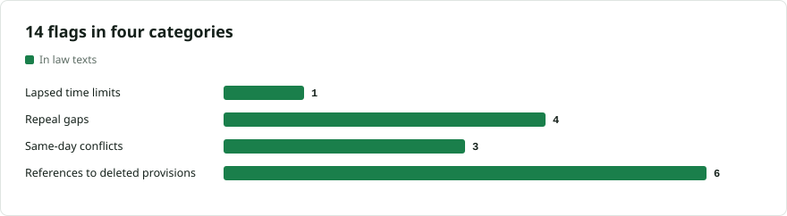

# Vulnerabilities in Paraguayan law

[Español](README.md) · **English**

<picture>
<source media="(prefers-color-scheme: dark)" srcset="img/flags-by-category-dark.svg">

</picture>

The vulnerability detectors from [lexifina/global-law](https://github.com/lexifina/global-law/tree/main/vulnerabilities) look for mechanical mistakes in legislation: a rule applying "until" a date that has passed, a time limit extended only after it had run out, a provision repealed before its replacement took effect, an amount changed in one place but not in another, a reference to an article that no longer exists. global-law's published list (9 November 2026) covered Paraguay with 8 flags from an earlier copy of this repository: 2 publisher notes (called failed amendments there), 2 dead currencies, 1 repeal gap, 1 reference to a repealed placeholder, 1 same-day conflict and 1 reference to a deleted provision; its review judged 3 artefacts and 1 lawful, and did not review the other 4. This is a run over this repository only, as it stood at commit [`8af7e93`](https://github.com/lexifina/paraguay-law/commit/8af7e935ae3c50acbc895ddc296f1e8790798539) on 16 November 2026, with its whole history. Three of those 8 flags come up again; the publisher notes and the currencies were misreadings (see below), and neither they nor the reference to a repealed placeholder are flagged any more.

**In short:** the detectors raised 14 flags. A language model reviewed all of them, arguing each one for and against; none survived. Read by hand in this repository and, for three laws it does not hold, on BACN, seven of them lead to four legislative oversights that look real: item 2 of Article 8 of the Criminal Code, rewritten by Ley N° 7062/2023, still refers to Articles 129b and 129c, which Ley N° 4788/2012 had repealed ten years earlier; Article 79(f) of the General Banking Law refers to Article 131, repealed wholesale by Ley N° 2334/2003; Ley N° 5456/2015 again declares repealed three articles of the copyright, trademark and industrial design laws that Ley N° 4798/2012 had re-enacted with new wording; and the twenty-four-month time limit for exchanging bearer shares in Ley N° 5895/2017 ran out on 10 October 2019, two days before Ley N° 6399/2019, which replaced it, took effect, with no rule for the day in between. Of the other 7, 2 come from how this repository splits articles that a law replaces with lettered articles, 2 are detector misreadings and 3 are lawful. Later, this will be formalised in Lean, similar to our work on [the US tax code](https://lexifina.com/blog/formalizing-the-us-tax-code) and [US case law](https://lexifina.com/blog/formalizing-all-us-case-law-in-lean).

A flag is a prompt to look, not legal advice, and nothing here has been tested in court.

## Flags by category

| Category | What it looks for | Flags | In law texts | Reviewed | Survived review |
| --- | --- | ---: | ---: | ---: | ---: |
| Lapsed time limits | Text still applying a rule "until" a date that has passed | 1 | 1 | 1 | 0 |
| Repeal gaps | A provision removed before its replacement took effect | 4 | 4 | 4 | 0 |
| Same-day conflicts | Two laws amending the same provision on the same day | 3 | 3 | 3 | 0 |
| References to deleted provisions | A provision citing an article that no longer exists | 6 | 6 | 6 | 0 |

"In law texts" counts every file of the acts' folders: the Constitution, the codes and the laws (`constitucion/`, `codigo-civil/`, `ley-.../` and the others), with their enacting formulas (`sancion.md`); it does not count each folder's `README.md` or `indice.md`, `data/`, `tools/` or the documentation. This repository holds 92 acts, nearly all without dated time limits: the search for lapsed time limits found a single date. It does not read the 3 phrases that give only a year or a month ("hasta el año 2011", "hasta el año 2014", "hasta el mes de febrero del año 1996", until the year or month named), all past, nor deadlines worded "antes del 31 de marzo del año 2000" (before 31 March 2000), nor relative time limits ("dentro de un plazo máximo de veinticuatro meses contados desde la vigencia de la presente ley", within at most twenty-four months of the law taking effect; there are at least 17 counted from the law's promulgation or entry into force); one of them, in the original text of Ley N° 5895/2017, gives the empty period described above. The search for dead currencies found nothing, rightly: the guaraní is the currency in use, and the Customs Code's amounts are in US dollars (U$S). It used to read the "8. marco penal:" (sentencing range) of Article 14 of the Criminal Code as the German mark, and the search for publisher notes took the "Si ésta no pudo realizarse" (if the sale could not be made) of Article 982 of the Civil Code for a note on a failed amendment; both searches were corrected for Spanish (see How it was made). The search for stale amounts does not read amounts in guaraníes ("G. 50.000.000.000") or in dollars, and here it read only percentages; but this repository has few sums of money (14 in guaraníes, in figures or in words, and a dozen in dollars, nearly all in the Customs Code), and its fines are nearly always set in minimum daily wages (jornales mínimos); it found nothing. A repealed article disappears from its folder here, leaving no file that says "derogado", so the search for references to repealed placeholders found nothing; nor did the searches for duplicate numbering and dead fines.

*Edge cases: the 14 flags, grouped by what they turned out to be, in [EDGE-CASES.en.md](EDGE-CASES.en.md).*

## Problems found in this repository

- **A note in [`REPRODUCE.md`](../REPRODUCE.md) that is no longer true:** the entry for Ley N° 4788/2012 (the comprehensive law against trafficking in persons) ends with "Known gap: the Código Penal in this repository does not yet apply that repeal and still shows both articles after that day", but the history applies the repeal of Articles 129b and 129c of the Criminal Code from 19 December 2012 ([the change](https://github.com/lexifina/paraguay-law/commit/60182e5a844116abe5934ff1c6d3ee03de78da04)), as the Criminal Code's entry in the same file says.

## Files

| File | Contents |
| --- | --- |
| [data/flags.csv](data/flags.csv) | Every flag, one row per provision and issue |
| [data/reviewed.csv](data/reviewed.csv) | The 14 flags the model reviewed, with its verdict and reason |
| [data/by_category.csv](data/by_category.csv) | The figures in the table above |
| [tools/](tools/) | The scripts behind this run |

Columns: `category` and `category_es` (the category in English and in Spanish), `detector`, `kind` (`law` or `other`), `path` (the file in this repository), `date` (the date the flag turns on), `reference` (the law or the line concerned), `summary`, `score` (the detector's score, 0 to 1), `review` (`artefact`, `lawful` or `candidate_defect`), `survives_rebuttal`, `review_note` (the model's reason), `url` (the provision at the commit read or, if it was removed earlier, at the last commit that held it).

## How it was made

- **Detectors:** global-law's [vulnerabilities/scripts](https://github.com/lexifina/global-law/tree/main/vulnerabilities/scripts), run on this repository at commit `8af7e93`. global-law replays this repository only up to an earlier commit, so the history table the detectors read was built from this repository's own commits (the law that made each change, its `In-force` date and its `Kind`; the laws, Constitutional Amendment N° 1 of 2011, approved by referendum, and the one change no law explains, credited to BACN, count as law, and documentation is left out). The detectors carry the fixes global-law's scripts received in the runs on other national repositories, among them the date forms of Spanish as written in Spain and Colombia ("hasta el día 31 de diciembre de 2020", "1o. de enero", "a más tardar el ..."), and two for Paraguayan Spanish: "marco" is read as a currency only as "marcos" after an amount or as "marco(s) alemán/alemanes", and "no pudo realizarse" as a publisher note only when an amendment is its subject.
- **Model review:** gpt-5.4-mini, the 40 strongest flags per category, that is, all 14; one pass says whether the flag is real and another argues that it is not. No flag was an empty period, the category global-law reviews with its own procedure. global-law's own list used a different model.
- **Hand check:** each of the 14 flags was read in this repository's history and texts, and in the law that repeals, replaces or is referred to where this repository holds it (Leyes N° 2334/2003, 4788/2012 and 5895/2017, with the wording their amending laws gave them). On BACN, Leyes N° 4046/2010, 5456/2015 and 6399/2019, which this repository does not hold, were read. The time-limit phrases the detector does not read and the amounts in guaraníes were also read, by the words found.

To report a correction, open an issue with the provision and an official source.

## Licence

The lists and notes are Lexifina's and are dedicated to the public domain under CC0 1.0, like this repository's other own contributions. The legal text quoted is official text of the Republic of Paraguay as published by the Biblioteca y Archivo Central del Congreso Nacional (BACN), which states no licence for its pages; under Ley N° 1328/1998 on Copyright and Related Rights, Article 8(2), official texts of a legislative, administrative or judicial nature are not protected by copyright, without prejudice to the duty to respect the texts and cite the source. BACN does not endorse this repository. See [LICENSE](../LICENSE).
