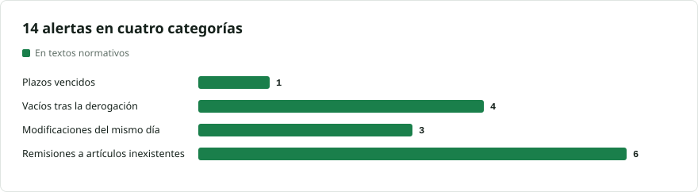

# Vulnerabilidades en el derecho paraguayo

**Español** · [English](README.en.md)

<picture>
<source media="(prefers-color-scheme: dark)" srcset="img/flags-by-category-dark.es.svg">

</picture>

Los detectores de vulnerabilidades de [lexifina/global-law](https://github.com/lexifina/global-law/tree/main/vulnerabilities) buscan errores mecánicos en la legislación: una regla que sigue aplicándose «hasta» una fecha ya pasada, un plazo prorrogado cuando ya había vencido, una disposición derogada antes de que entrara en vigencia la que la sustituye, un monto modificado en un lugar pero no en otro, una remisión a un artículo que ya no existe. La lista que global-law publicó el 9 de noviembre de 2026 incluía el Paraguay con 8 alertas, obtenidas de una copia anterior de este repositorio: 2 notas del editor (allí llamadas modificaciones fallidas), 2 monedas sin curso legal, 1 vacío tras la derogación, 1 remisión a una disposición derogada, 1 modificación del mismo día y 1 remisión a una disposición inexistente; su revisión dio 3 por artefactos y 1 por conforme a derecho, y no revisó las otras 4. Esta es una revisión de este repositorio solamente, en el estado del commit [`8af7e93`](https://github.com/lexifina/paraguay-law/commit/8af7e935ae3c50acbc895ddc296f1e8790798539) de 16 de noviembre de 2026, con toda su historia. Tres de aquellas 8 alertas vuelven a aparecer; las notas del editor y las monedas eran lecturas erróneas (véase más abajo), y ni ellas ni la remisión a una disposición derogada se señalan ya.

**En resumen:** los detectores generaron 14 alertas. Un modelo de lenguaje las revisó todas, con argumentos a favor y en contra de cada una; ninguna resistió. Leídas a mano en este repositorio y, para tres leyes que este no contiene, en la BACN, siete de ellas conducen a cuatro descuidos del legislador que parecen reales: el numeral 2 del artículo 8 del Código Penal, al que la Ley N° 7062/2023 dio nueva redacción, sigue remitiendo a los artículos 129b y 129c, que la Ley N° 4788/2012 había derogado diez años antes; el inciso f) del artículo 79 de la Ley General de Bancos remite al artículo 131, derogado en bloque por la Ley N° 2334/2003; la Ley N° 5456/2015 vuelve a declarar derogados tres artículos de las leyes de derecho de autor, de marcas y de dibujos y modelos industriales que la Ley N° 4798/2012 había vuelto a sancionar con nueva redacción; y el plazo de veinticuatro meses para canjear las acciones al portador de la Ley N° 5895/2017 venció el 10 de octubre de 2019, dos días antes de que entrara en vigencia la Ley N° 6399/2019 que lo sustituyó, sin regla alguna para el día intermedio. De las otras 7, 2 se explican por cómo este repositorio divide los artículos que una ley sustituye por artículos con letra, 2 son lecturas erróneas del detector y 3 son conformes a derecho. Más adelante se formalizará en Lean, como nuestro trabajo sobre [el código tributario de EE. UU.](https://lexifina.com/blog/formalizing-the-us-tax-code) y [la jurisprudencia de EE. UU.](https://lexifina.com/blog/formalizing-all-us-case-law-in-lean).

Una alerta es una invitación a examinar el texto, no un asesoramiento jurídico, y nada de lo aquí expuesto se ha sometido a un juez.

## Alertas por categoría

| Categoría | Qué busca | Alertas | En textos normativos | Revisadas | Resistieron la revisión |
| --- | --- | ---: | ---: | ---: | ---: |
| Plazos vencidos | Un texto que sigue aplicando una regla «hasta» una fecha ya pasada | 1 | 1 | 1 | 0 |
| Vacíos tras la derogación | Una disposición retirada antes de que entrara en vigencia la que la sustituye | 4 | 4 | 4 | 0 |
| Modificaciones del mismo día | Dos leyes que modifican la misma disposición el mismo día | 3 | 3 | 3 | 0 |
| Remisiones a disposiciones inexistentes | Una disposición que remite a un artículo que ya no existe | 6 | 6 | 6 | 0 |

«En textos normativos» cuenta todos los archivos de las carpetas de normas: la Constitución, los códigos y las leyes (`constitucion/`, `codigo-civil/`, `ley-.../` y las demás), con sus fórmulas de sanción (`sancion.md`); no cuenta el `README.md` ni el `indice.md` de cada carpeta, `data/`, `tools/` ni la documentación. Este repositorio contiene 92 normas, casi todas sin plazos fechados: la búsqueda de plazos vencidos halló una sola fecha. No lee las 3 expresiones que solo indican un año o un mes («hasta el año 2011», «hasta el año 2014», «hasta el mes de febrero del año 1996»), todas ya pasadas, ni los plazos «antes del 31 de marzo del año 2000», ni los plazos relativos («dentro de un plazo máximo de veinticuatro meses contados desde la vigencia de la presente ley»; hay al menos 17 contados desde la promulgación o la vigencia de la ley); de uno de ellos, el del texto original de la Ley N° 5895/2017, nace el periodo de vacío descrito arriba. La búsqueda de monedas sin curso legal no halló nada, y con razón: el guaraní es la moneda en curso, y los montos del Código Aduanero están en dólares (U$S). Antes leía como marco alemán el «8. marco penal:» del artículo 14 del Código Penal, y la de notas del editor tomaba por la nota de una modificación fallida el «Si ésta no pudo realizarse» del artículo 982 del Código Civil; ambas búsquedas se corrigieron para el español (véase «Cómo se hizo»). La búsqueda de montos no actualizados no lee montos en guaraníes («G. 50.000.000.000») ni en dólares, y aquí solo leyó porcentajes; pero este repositorio tiene pocos montos en dinero (14 en guaraníes, en cifras o en letras, y una docena en dólares, casi todos en el Código Aduanero), y sus multas se fijan casi siempre en jornales mínimos; no halló nada. Un artículo derogado desaparece aquí de su carpeta, sin dejar un archivo que diga «derogado», de modo que la búsqueda de remisiones a disposiciones derogadas no halló nada; tampoco la de numeración duplicada ni la de sanciones sin conducta tipificada.

*Casos límite: las 14 alertas, agrupadas según lo que resultaron ser, en [EDGE-CASES.md](EDGE-CASES.md).*

## Problemas detectados en este repositorio

- **Una nota que ya no es cierta en [`REPRODUCE.md`](../REPRODUCE.md):** la entrada de la Ley N° 4788/2012 Integral contra la Trata de Personas termina con «Known gap: the Código Penal in this repository does not yet apply that repeal and still shows both articles after that day», pero el historial aplica la derogación de los artículos 129b y 129c del Código Penal desde el 19 de diciembre de 2012 ([el cambio](https://github.com/lexifina/paraguay-law/commit/60182e5a844116abe5934ff1c6d3ee03de78da04)), como dice la entrada del Código Penal en el mismo archivo.

## Archivos

| Archivo | Contenido |
| --- | --- |
| [data/flags.csv](data/flags.csv) | Todas las alertas, una fila por disposición y problema |
| [data/reviewed.csv](data/reviewed.csv) | Las 14 alertas que revisó el modelo, con su veredicto y su motivo |
| [data/by_category.csv](data/by_category.csv) | Las cifras de la tabla anterior |
| [tools/](tools/) | Los scripts de esta revisión |

Columnas: `category` y `category_es` (la categoría en inglés y en español), `detector`, `kind` (`law` u `other`), `path` (el archivo en este repositorio), `date` (la fecha de la que depende la alerta), `reference` (la ley o la línea afectada), `summary`, `score` (la puntuación del detector, de 0 a 1), `review` (`artefact`, `lawful` o `candidate_defect`), `survives_rebuttal`, `review_note` (el motivo del modelo, en inglés), `url` (la disposición en el commit leído o, si se suprimió antes, en el último commit que la contenía).

## Cómo se hizo

- **Detectores:** los [vulnerabilities/scripts](https://github.com/lexifina/global-law/tree/main/vulnerabilities/scripts) de global-law, ejecutados sobre este repositorio en el commit `8af7e93`. global-law reproduce este repositorio solo hasta un commit anterior, por lo que la tabla histórica que leen los detectores se construyó con los propios commits de este repositorio (la ley que hizo cada cambio, su fecha `In-force` y su `Kind`; las leyes, la Enmienda Constitucional N° 1 de 2011, aprobada por referéndum, y el único cambio que ninguna ley explica, atribuido a la BACN, cuentan como derecho, y se excluye la documentación). Los detectores incorporan las correcciones que los scripts de global-law recibieron en las revisiones de otros repositorios nacionales, entre ellas las formas de fecha del español de España y de Colombia («hasta el día 31 de diciembre de 2020», «1o. de enero», «a más tardar el ...»), y dos para el español del Paraguay: «marco» se lee como moneda solo en «marcos» tras un monto o en «marco(s) alemán(es)», y «no pudo realizarse» solo como nota del editor cuando su sujeto es una modificación.
- **Revisión por el modelo:** gpt-5.4-mini, las 40 alertas más sólidas de cada categoría, es decir, las 14; una pasada dice si la alerta es real y otra argumenta que no lo es. Ninguna alerta fue un periodo de vacío normativo, la categoría que global-law revisa con su propio procedimiento. La lista propia de global-law usó otro modelo.
- **Comprobación manual:** cada una de las 14 alertas se leyó en la historia y los textos de este repositorio, y en la ley que deroga, sustituye o remite cuando este repositorio la contiene (las Leyes N° 2334/2003, 4788/2012 y 5895/2017, con la nueva redacción que les dieron sus modificatorias). En la BACN se leyeron las Leyes N° 4046/2010, 5456/2015 y 6399/2019, que este repositorio no contiene. Se leyeron también, por las palabras halladas, las expresiones de plazo que el detector no lee y los montos en guaraníes.

Para comunicar una corrección, abra una incidencia con la disposición y una fuente oficial.

## Licencia

Las listas y las notas son de Lexifina y se dedican al dominio público con CC0 1.0, como las demás aportaciones propias de este repositorio. El texto jurídico citado es texto oficial de la República del Paraguay, tal como lo publica la Biblioteca y Archivo Central del Congreso Nacional (BACN), que no indica ninguna licencia para sus páginas; según la Ley N° 1328/1998 de Derecho de Autor y Derechos Conexos, art. 8, numeral 2, los textos oficiales de carácter legislativo, administrativo o judicial no son objeto de protección por el derecho de autor, sin perjuicio de la obligación de respetar los textos y citar la fuente. La BACN no avala este repositorio. Véase [LICENSE](../LICENSE).
